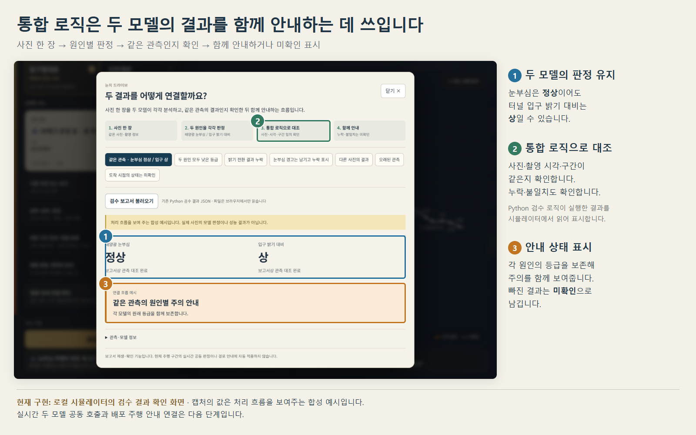
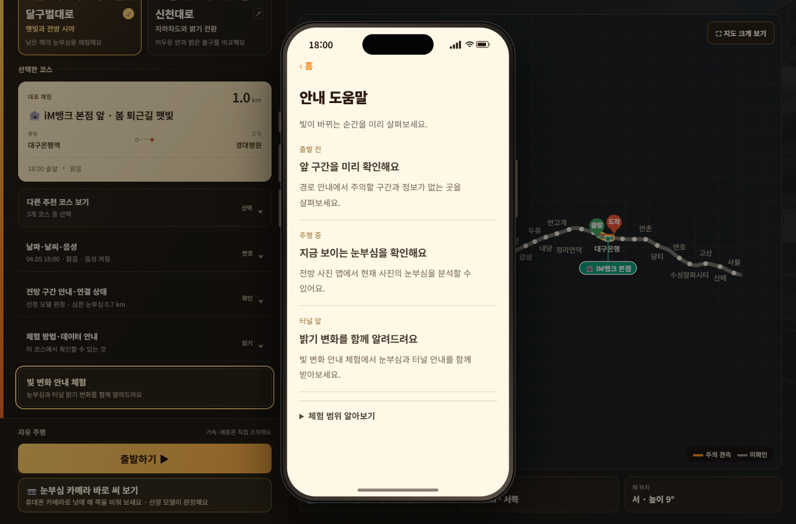
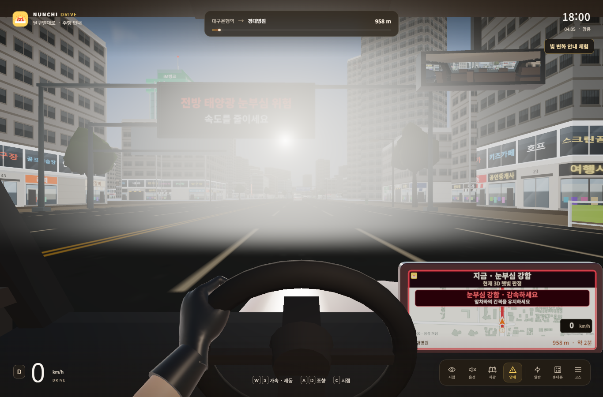
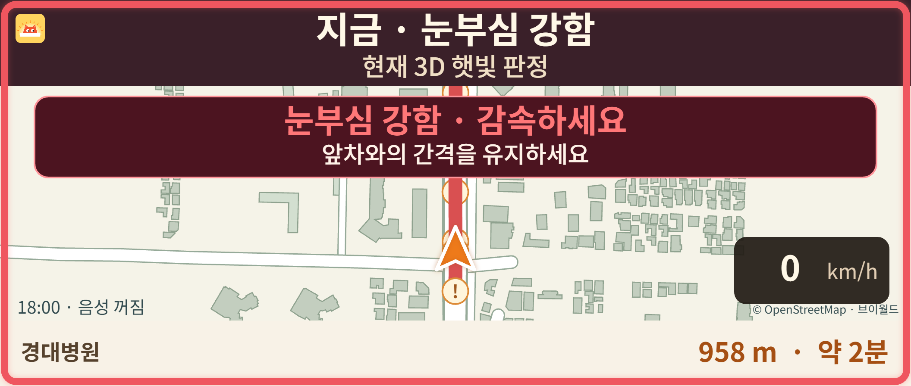

# 사용자 화면과 전방 카메라 입력 개선

## 사용자 화면

- 통합 안내는 터널 진입·강한 햇빛·두 원인 주의·정보 부족 상황에서 운전자가 받게 될 안내를 보여준다. 보고서 업로드와 개발자 정보는 제거했다.
- 휴대폰 홈은 상태를 짧게 표시한다. 경로는 거리·주의 구간 요약, 카메라는 사진 결과·행동 안내, 설정은 자주 쓰는 항목을 먼저 보여준다. 긴 설명은 접어서 확인한다.
- 카메라는 사진 한 장의 결과를 확인한 뒤 ‘다시 찍어 분석’한다. 분석 도중에 결과가 반복해서 사라지지 않는다. 사진·촬영정보 전송 동의는 유지한다.
- 강한 정면 햇빛에서 전방 차선과 차량의 대비 저하를 강화했다. 차광판·건물 가림·흐림 조건을 반영하며, 계기판과 내비게이션은 보호한다.
- 내비게이션의 지도 색 대비, 건물 윤곽, 지명 글자와 텍스처 필터링을 개선했다. 기존 경고 문구는 유지한다.
- 앞바퀴 조향과 바퀴의 굴러가는 회전을 별도 축으로 연결했다. 키보드·터치 입력을 따르고 입력을 놓으면 중립으로 복귀한다.

## ‘강한 눈부심인데 사진은 정상’ 조사

같은 시뮬레이터 위치·날씨에서 기존 넓은 창 입력(1920×887)을 선정 모델 API에 보내면 0이 나왔고, 다른 창 비율에서는 2가 나왔다. 3D 장면의 경고와 사진 모델은 서로 다른 신호이며, 전체 브라우저 화면을 모델 입력으로 사용하면 가상 카메라의 촬영 범위까지 바뀌는 문제를 확인했다.

`captureCameraFrame`은 이제 휴대폰·잡은 손 연출을 제외하고, 고정 66° 화각·16:9의 전방 영역을 캡처한다. 잘라낸 사진에 맞는 화각·크기·위치·방향·시각을 함께 보낸다. 실제 휴대폰 카메라 영상은 이 가상 카메라 처리를 적용하지 않는다.

선정 모델 `photo-g-candidate-v1 / B_geometry_aug`의 가중치와 .5/.5 임계값은 바꾸지 않았다. 수정 뒤 동일한 강한 햇빛 장면을 1920×887, 1100×760, 844×390 창에서 실제 API로 확인했고 세 경우 모두 2가 나왔다. 요청 JPEG SHA-256과 응답 사진 지문, 촬영 시각을 대조했다. 이는 해당 시연 입력에 대한 재현 검사이며 실제 도로 정확도·사고 예방 성능 검증은 아니다.

모델 결과를 3D 연출 등급으로 덮어쓰지 않는다. 사진 판정은 ‘사진 · 눈부심 낮음’처럼 범위를 표시하며, 두 신호가 다르면 주의 안내를 유지하고 차이를 알린다.

## 캡처

### 후속 화면 조정

- 정면 눈부심의 넓고 불투명한 덮임을 줄이고, 해 위치에서 부드럽게 옅어지는 빛 번짐으로 조정했다. 인위적인 별 모양 광선과 큰 간격의 흐림을 없애고, 작은 가중 평균 필터로 윤곽이 겹쳐 보이는 현상을 줄였다. 전방 대비 저하는 유지하며 내비게이션·계기판 영역은 보호한다.
- 운전자에게 보이는 ‘모델 ③’·‘순응 위험 상/중/하’는 ‘지하차도 진입 · 밝기 변화 큼/보통/작음’으로 바꿨다. 주행 경고·내비게이션·전광판에 적용하고 등급 계산과 진입 시점은 유지한다.
- 이는 화면 연출·문구 변경이며 모델 가중치나 임계값 변경이 아니다. 저장된 경로 사진 판정은 `rendererRevision`으로 구분한 기존 촬영 당시의 결과다.

실제 API 재현의 원본 JPEG·촬영정보·응답은 로컬 `output/model-mismatch-audit/`에, 저장 경로 판정 재생성의 요청·응답은 `output/model-route-cache/`에 보관한다. 해당 입력은 시뮬레이터 합성 이미지이며 저장 폴더는 Git에서 제외한다.
