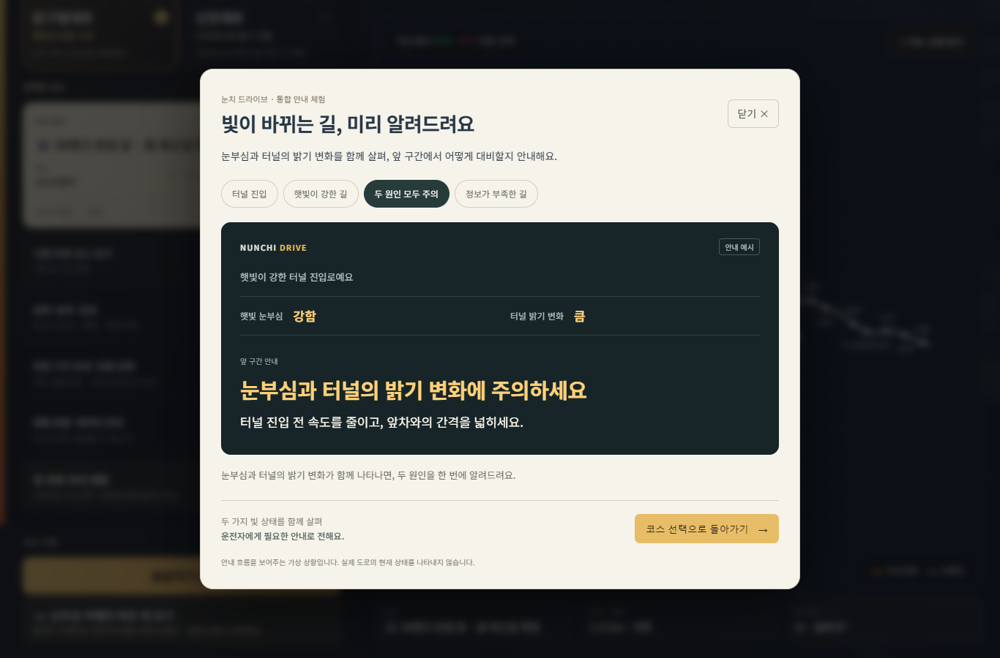
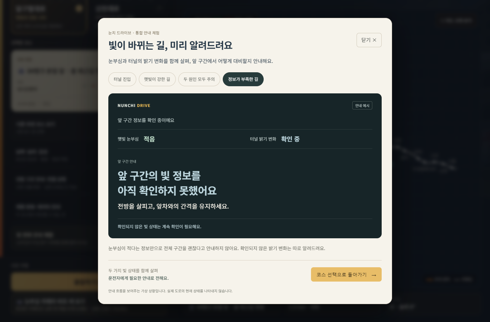

# 사용자 관점의 통합 주행 안내 체험

메인 화면과 주행 HUD의 **빛 변화 안내 체험**에서 운전자가 받게 될 안내를 상황별로 확인한다. 보고서 업로드·사진 지문·관측 ID·모델 버전 등 개발 기능은 제공하지 않는다.

| 주행 상황 | 함께 살피는 빛 상태 | 운전자 안내 |
|---|---|---|
| 터널 진입 | 눈부심 적음 · 터널 밝기 변화 큼 | 터널에 들어가면 앞이 어두워질 수 있음, 진입 전 감속·차간 거리 확보 |
| 햇빛이 강한 길 | 눈부심 강함 · 터널 밝기 변화 작음 | 강한 햇빛에 대한 주의, 감속·차간 거리 확보 |
| 두 원인 모두 주의 | 눈부심 강함 · 터널 밝기 변화 큼 | 두 원인을 한 안내로 전달, 진입 전 감속·차간 거리 확보 |
| 정보가 부족한 길 | 눈부심 적음 · 터널 밝기 변화 미확인 | 앞 구간 정보 확인 중, 전방 주시·차간 거리 유지 |

## 화면

## 통합 로직의 역할

사진 한 장의 눈부심과 터널 입구 밝기 대비를 각 모델이 분석한다. 기존 Python 통합 검수 로직이 사진·시각·구간 대응과 누락을 확인한 결과를 읽고, `driverGuidance`가 원인을 유지하며 사용자 안내 문구로 바꾼다. 한 원인이 낮아도 다른 원인의 주의를 없애지 않는다. 확인되지 않은 결과를 낮음으로 표시하지 않는다.

내장 상황은 Python 원본 검수 로직으로 생성한 **합성 체험 사례**다. 화면에는 ‘안내 예시’와 가상 상황임을 표시한다. 현재 주행 구간의 실시간 공동 판정으로 주입하지 않는다. 체험 중에는 주행과 음성을 멈추고 닫으면 복귀한다.

## 내부 데이터와 검증

`python scripts/export_integration_examples.py`는 나란히 있는 AI 저장소의 `integration_probe.run_cases`를 실행한다. 데이터에는 원본 코드 SHA-256과 합성 출처 표시를 보존한다. UI에는 개발자 메타데이터를 표시하지 않는다.

실시간 공동 API는 같은 JPEG와 공통 촬영정보로 두 모델을 실행하고, 입력 출처·응답 시점·관측 대응을 검증한 뒤 연결해야 한다. 이번 PR은 사용자 안내 체험이며 실시간 공동 API 배포를 포함하지 않는다.

## 전방 카메라 입력

브라우저 창 전체 대신 고정 66°·16:9 전방 영역을 사용한다. 휴대폰을 든 3D 연출은 촬영에서 제외한다. 사진에 맞는 촬영 정보를 전송하며 모델 결과를 연출 값으로 덮어쓰지 않는다. 카메라의 판정은 사진 한 장에 대한 것이고 통합 안내 예시는 별도 가상 상황이다.
